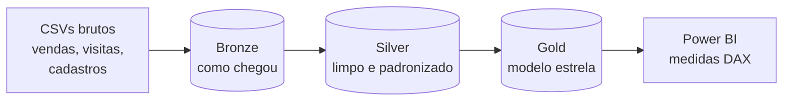

# Demo: lakehouse em camadas (bronze → silver → gold) para inteligência comercial

Versão **local e executável** do padrão que uso no Microsoft Fabric, com **dados 100% sintéticos** de uma força de vendas farmacêutica (vendas + visitas a médicos).



## O que a demo mostra

| Camada | Arquivo | O que faz |
|---|---|---|
| Dados | `gerar_dados.py` | Gera os CSVs sintéticos (vendas, visitas, cadastros) |
| Bronze | `sql/01_bronze.sql` | Ingestão sem tratamento + metadados de carga (`_fonte`, `_carregado_em`) |
| Silver | `sql/02_silver.sql` | Corrige datas em 2 formatos, códigos em minúsculas, vírgula decimal, nulos e duplicatas; separa rejeitados para auditoria |
| Gold | `sql/03_gold.sql` | Dimensões (vendedor, produto, calendário) e fatos (vendas, visitas) |
| Qualidade | `sql/04_checks.sql` | Contagens por camada, integridade referencial e uma análise de negócio |
| BI | `powerbi/medidas_dax.md` | Medidas DAX: faturamento, visitas, var. % mês, YTD, ranking |

Os dados são gerados por `gerar_dados.py` (semente fixa) e os problemas de qualidade são **colocados de propósito**, para a camada silver ter o que resolver.

## Como rodar

```bash
pip install duckdb pandas
python run_demo.py
```

Saída esperada (trecho):

```
                  tabela  linhas
           bronze_vendas     294
           silver_vendas     288
silver_vendas_rejeitadas       5
```

## Equivalência com o Microsoft Fabric

| Aqui | No Fabric |
|---|---|
| DuckDB + arquivos SQL | Lakehouse + notebooks (Spark SQL) ou Warehouse |
| Tabelas `bronze_*`, `silver_*` | Tabelas Delta por camada, com padrão de nomes |
| Tabelas `dim_*` / `fato_*` | Modelo semântico **Direct Lake** |
| `run_demo.py` | Pipeline de dados orquestrando os notebooks |
